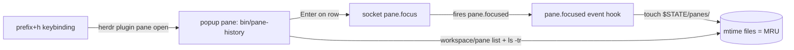

# herdr-history — pane history navigator plugin

Goal: navigate back through previously focused Herdr panes via a dialog like
`sushidesu/herdr-tabpick` (popup picker, MRU-ordered), plus publish it on the
official Herdr plugin marketplace.

## Research findings

### Plugin model (https://herdr.dev/tui/docs/plugins/)
- Plugin = directory with `herdr-plugin.toml` + argv commands (any language).
  The whole Herdr CLI is the plugin API; call it via `HERDR_BIN_PATH`.
- Manifest declares `[[build]]`, `[[startup]]`, `[[actions]]`, `[[events]]`,
  `[[panes]]`, `[[link_handlers]]`. Commands are argv arrays — no shell.
- **No native plugin UI in v1.** A "dialog" is a terminal popup:
  `[[panes]]` with `placement = "popup"` (session-modal, `width`/`height` as
  cells or `%`, receives all input incl. Esc, closes when the command exits or
  on `popup.close`). Popup has no pane ID and emits no pane lifecycle events,
  so opening the dialog does not pollute the focus history.
- Runtime env: `HERDR_BIN_PATH`, `HERDR_SOCKET_PATH`, `HERDR_PLUGIN_STATE_DIR`,
  `HERDR_PLUGIN_CONFIG_DIR`, `HERDR_PLUGIN_CONTEXT_JSON`, `HERDR_PLUGIN_EVENT(_JSON)`.
- Event hooks spawn **independently per event** — no locking, no shared
  read-modify-write. Only per-key atomic updates are safe.
- Herdr exposes **no last-focused timestamp**. MRU must be observed live.

### How the tabpick dialog works (github.com/sushidesu/herdr-tabpick)
Two halves in one plugin:
1. `[[panes]] id="open" placement="popup" width="90%" height="80%" command=["./bin/tabpick"]`
   — the dialog is just an fzf picker running inside a popup pane. Rows built
   from `herdr workspace list` / `tab list` / `pane list` JSON (joined with
   `jq`), fzf `--preview` shows `herdr pane read` of the row's pane; Enter runs
   `herdr tab focus`.
2. `[[events]] on = "tab.focused"` hook:
   `mkdir -p "$HERDR_PLUGIN_STATE_DIR/tabs" && touch "$HERDR_PLUGIN_STATE_DIR/tabs/$HERDR_TAB_ID"`
   — one empty file per id, filename = id, **mtime = last focus**. Atomic per
   key without locking. Picker sorts by `ls -tr` mtime order.

Keybinding (user config):
```toml
[[keys.command]]
key = "prefix+t"
type = "shell"
command = "herdr plugin pane open --plugin sushidesu.tabpick --entrypoint open"
```
`herdr plugin pane open` without `--placement` uses the manifest placement
(the CLI `--placement` enum on 0.9.5 lacks `popup`; manifest/`plugin.pane.open`
socket request both support it).

### Critical quirk: focus-by-id
CLI `herdr pane focus` only moves focus by **direction**. There is **no
pane-focus-by-id in the CLI** (confirmed in KazBrekker1/herdr-hasr `herd.go`:
"the CLI has no pane-focus-by-id"). Precise jump to any pane requires the raw
socket method `pane.focus` over `HERDR_SOCKET_PATH`:
```json
{"id":"req","method":"pane.focus","params":{"pane_id":"w1:p2"}}
```
Fallbacks: `herdr tab focus <tab_id>` (lands on the tab's remembered pane, not
necessarily the selected one), `herdr agent focus <name>` for agent panes.

### Prior art (scope overlap)
- `beyondlex/herdr-recent-navigator` — Rust; MRU popup over
  workspaces/tabs/panes/agents + `focus-previous-pane` quick action. Closest
  existing plugin; ours is a focused pane-history dialog, smaller.
- `KazBrekker1/herdr-hasr`, `asumaran/herdr-goto`, `solidsnakedev/herdr-jump` —
  goto-style switchers, same popup + focus techniques.

## Design



- **History source**: `[[events]] on = "pane.focused"` → touch
  `$HERDR_PLUGIN_STATE_DIR/panes/$HERDR_PANE_ID`. Pane IDs are never reused
  (`w1:pN`), so per-key files are collision-free and atomic.
- **Dialog**: `[[panes]] id="picker" placement="popup"` running an fzf picker
  (same pattern as tabpick): rows = live panes joined against mtime rank, MRU
  first; row shows `workspace:tab label | pane id | agent/status | cwd |
  foreground cmd`; fzf `--preview` = `herdr pane read <pane_id> --source visible`.
  Enter → `pane.focus` via socket helper, then exit (popup auto-closes).
  Esc/q → exit without jumping.
- **Stale entries**: picker joins against live `pane list`; files for closed /
  moved-away panes are pruned there (move re-qualifies the pane ID, old file
  goes stale). No `pane.closed` hook needed.
- **Shipped (walk)**: `[[actions]] id="previous"/"next"` walk the focus order
  relative to the focused pane (bound to `super+ctrl+j/k`). Jumps re-fire
  `pane.focused`, so each walk jump leaves a "suppress next touch" marker the
  event hook consumes: the walked order stays stable and `next` retraces
  exactly the path `previous` took.

## Implementation

Repo layout (Bun-free, POSIX; targets linux + macos like tabpick):

```
herdr-history/
  herdr-plugin.toml
  bin/pane-history        # bash + fzf + jq: list / picker (modeled on tabpick)
  bin/herdr-rpc           # tiny helper: JSON-RPC over $HERDR_SOCKET_PATH (pane.focus)
  README.md
  LICENSE
```

`bin/pane-focus`: python3-stdlib (or node) unix-socket client, ~30 lines —
write one JSON request, read one JSON reply, exit non-zero on error. Only
non-CLI piece in the plugin; document it in README.

`herdr-plugin.toml`:

```toml
id = "riogesulgon.pane-history"
name = "MRU Pane History"
version = "0.2.0"
min_herdr_version = "0.7.4"   # popup placement + plugin events
description = "Navigate back through recently focused panes, MRU-first."
platforms = ["linux", "macos"]

[[panes]]
id = "picker"
title = "Pane history"
placement = "popup"
width = "80%"
height = "60%"
command = ["./bin/pane-history"]

[[events]]
on = "pane.focused"
command = ["sh", "-c", "mkdir -p \"$HERDR_PLUGIN_STATE_DIR/panes\" && touch \"$HERDR_PLUGIN_STATE_DIR/panes/$HERDR_PANE_ID\""]
```

Steps:
1. Scaffold manifest + `pane.focused` hook → verify: link plugin, focus 3
   panes, `ls -ltr "$(herdr plugin config-dir <id>)/../../state..."` shows
   3 files ordered by focus; `herdr plugin log list` clean.
2. `bin/pane-history` list + fzf picker (rows MRU-first from
   `workspace list` + `pane list` + `ls -tr`, jq join like tabpick) → verify
   order and pruning with a closed pane.
3. `bin/herdr-rpc` socket helper (`pane.focus`) → verify: Enter focuses exactly the selected
   pane (`pane.get` shows `focused: true`), and the jump updates MRU.
4. Polish: preview pane, row formatting (agent status, cwd), Esc handling.
5. README: install, keybinding snippet, deps (`fzf`, `jq`, `python3`),
   troubleshooting (PATH note: herdr starts plugins with the server's PATH,
   not a login shell — same caveat tabpick documents).

Local dev loop: `herdr plugin link /mnt/ssd/home/rio/projects/herdr-history` →
`herdr plugin list --plugin <id>` → keybinding → `herdr plugin log list --plugin <id>`;
`herdr plugin unlink <id>` to unregister.

Keybinding for users (README):
```toml
[[keys.command]]
key = "prefix+h"
type = "shell"
command = "herdr plugin pane open --plugin riogesulgon.pane-history --entrypoint picker"
```
then `herdr server reload-config`.

## Publishing (official marketplace)

Marketplace = https://herdr.dev/tui/plugins/ — automatic index, **no
submission, no review** (https://herdr.dev/tui/docs/marketplace/):

1. Push to a **public GitHub repo** (e.g. `riogesulgon/herdr-history`) with
   `herdr-plugin.toml` on the default branch (root or subdir; required
   metadata `id`, `name`, `version`, `min_herdr_version` must parse).
2. Add GitHub topic **`herdr-plugin`** (repo → Manage topics).
3. Index refreshes every 30 min and rescans on default-branch head change.
   Card shows repo meta + manifest `name`/`version` per plugin. Forks and
   archived repos are excluded.
4. Users install with `herdr plugin install riogesulgon/herdr-history`; updates via
   `herdr plugin update` (picks up new default-branch commits).
5. README must cover: install command, keybinding, runtime deps, min herdr
   version, trust note (manifest + scripts skimmable — keep `bin/` small and
   readable; install shows a preview of commands before running them).

## Verification checklist (before publish)

- [ ] `herdr plugin link` on clean state: hook creates mtime files on every
      focus source (sidebar click, keybinding, `herdr tab focus`).
- [ ] Picker order == focus order, most recent first; never-focused pane falls
      to the end (by pane number).
- [ ] Enter lands on the exact pane (not just its tab); Esc closes cleanly;
      popup does not appear in history.
- [ ] Closed/moved panes disappear from the list; stale state files pruned.
- [ ] `herdr plugin uninstall` + install from GitHub fork: install preview,
      registration, keybinding all work.
- [ ] Marketplace listing appears after topic add (≤ 30 min).
